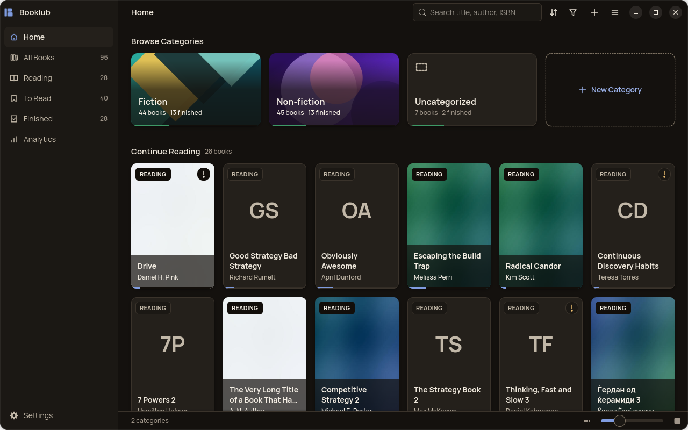
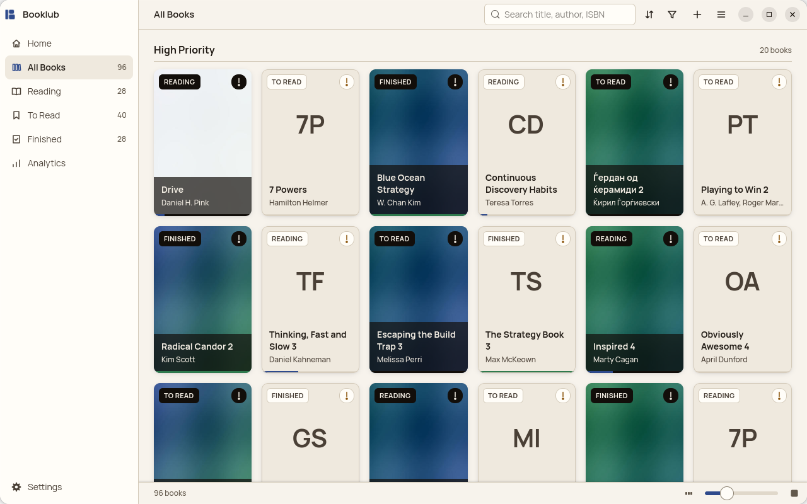
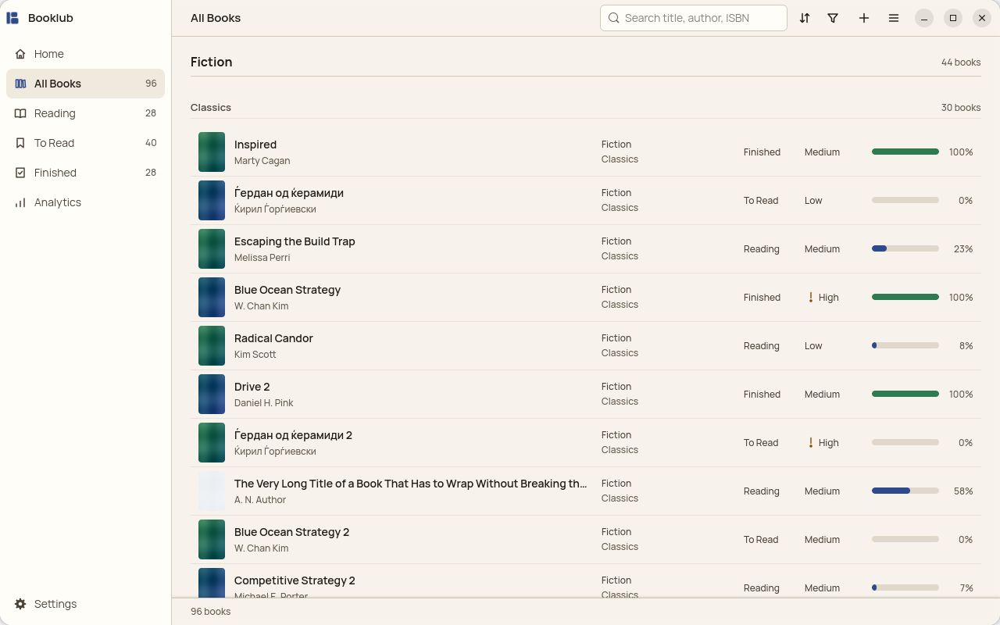

# Booklub

A private reading tracker for the Linux desktop, built in Rust with GTK4 and libadwaita. Books are vertical tiles, categories are horizontal ones, and your library stays in files on your own computer.

There's no account, no server, and no network access.



## Features

### Your library

- Add, edit, and delete books, with a warning if a title and author are already in your library
- Record title, author, pages, ISBN, publisher, year, language, rating (1 to 5), and notes
- Set a status: To Read, Reading, or Finished
- Set a priority: High, Medium, or Low
- ISBN-10 and ISBN-13 are checked as you save
- Edit in a side panel that asks before discarding unsaved changes, and closes with Esc

### Categories

- Organize books into categories and sub-categories, and create, rename, delete, and reorder them
- Deleting a category keeps its books
- New libraries start with Fiction and Non-fiction

### Backgrounds

- Give any book or category a background picture
- Upload a file, or copy an image from your browser and paste it
- Eight built-in artworks for categories
- Images up to 20 MB and 100 megapixels are accepted, with a warning if one is too small to look sharp
- Booklub keeps its own copy, so moving the original file doesn't matter

### Finding and arranging books

- Search by title, author, or ISBN as you type, ignoring case and accents, in Latin and Cyrillic
- Filter by category, sub-category, status, and priority, with a count beside each
- Sort by manual order, priority, category, status, title, or date added
- Sorting by priority or category adds section headings, including sub-categories
- Drag books into your own order, or use Alt and the arrow keys



### Reading progress

- Track your current page, with a progress bar on each book
- Start and finish dates fill in automatically when the status changes
- Marking a book Finished moves it to its last page

### Goals and Analytics

- Set a goal for books per year and books per month, or turn either off
- See how many you've finished, how many remain, and the books per week needed
- Goals show whether you're Ahead, On Track, or Behind
- See totals by status, books finished this year, average days to finish, and average rating
- Charts show books finished per month and how your books are spread across categories
- A table shows priority by status, and Booklub names your three smallest categories

### Views and appearance

- See books as pictures or as a list with cover, category, status, priority, and progress
- Tiles grow to fill the window, and a new column appears as soon as one fits
- A slider sets the tile size
- Follow the system's light or dark setting, or choose Light or Dark in Settings
- Layouts adapt to windows as narrow as 480 px
- Scrolls smoothly through 2,000 books, because only the tiles near the view exist as widgets



### Your data

- Import a spreadsheet (`.xlsx`), mapping its columns and statuses yourself and previewing the result
- Export to JSON, or to a `.booklub` backup file that includes your background images
- Restore a backup by replacing your library or merging into it
- A backup is made automatically before an upgrade changes the database

### Accessibility

- Every action works from the keyboard, with a visible focus ring
- Text and controls are measured against WCAG AA contrast in both modes
- Screen readers get names for every tile and control, including what colour alone would convey

## Install

Booklub is built and tested on Ubuntu 26.04. It needs Rust, GTK 4.22, and libadwaita 1.9 or newer.

```bash
sudo apt install rustc cargo libgtk-4-dev libadwaita-1-dev libsqlite3-dev pkg-config build-essential fonts-manrope
```

To try it without installing:

```bash
cargo run -p booklub-app --release
```

To build an installable package, and install it:

```bash
cargo install cargo-deb
```

```bash
tools/build_release.sh
```

```bash
sudo apt install ./dist/booklub_1.2.1-1_amd64.deb
```

Booklub then appears in your application grid. [BUILDING.md](BUILDING.md) has the Windows and macOS steps, which should work but haven't been tested yet.

## Where your data lives

| What | Where |
|---|---|
| Library | `~/.local/share/booklub/library.sqlite3` |
| Background images | `~/.local/share/booklub/backgrounds/` |
| Backups made before upgrades | `~/.local/share/booklub/backups/` |
| Display settings | `~/.local/share/booklub/preferences.json` |
| Thumbnails, rebuilt when missing | `~/.cache/booklub/thumbnails/` |

Uninstalling the app leaves these folders in place. To keep one portable copy of your library, use **Import and Export** in the main menu.

## Project layout

```
assets/                  logo, app icon, interface icons, illustrations, category artwork
crates/booklub-core/     every domain rule and all storage, with no GTK dependency
crates/booklub-app/      the GTK interface
  resources/style.css    the only file holding colour values
  data/                  desktop entry, AppStream metadata, file type
docs/screenshots/        the pictures in this file, taken from made-up demo data
tools/                   screenshots and the release build
```

## Tests

```bash
cargo test --workspace
```

[tools/README.md](tools/README.md) covers the end-to-end run, which drives the real window, plus demo data and performance measurements. Those runs only touch the folders you point them at, so they won't affect your own library. The end-to-end run does replace your clipboard while it tests pasting.

## Licence

Booklub is released under the [ISC licence](LICENSE). It uses GTK and libadwaita, which are LGPL and linked dynamically, and Rust crates under permissive licences such as MIT, Apache-2.0, and Unicode-3.0. Manrope, its typeface, is under the SIL Open Font License and is installed separately.
